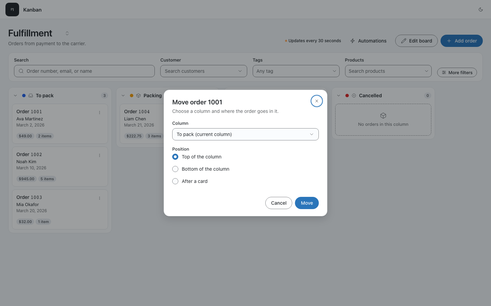

# ArtisanPack UI Ecommerce Kanban (Livewire)

The order kanban board for the [`artisanpack-ui/ecommerce`](https://github.com/ArtisanPack-UI/ecommerce) engine, built on
[`livewire-ui-components`](https://github.com/ArtisanPack-UI/livewire-ui-components) and
[`livewire-drag-and-drop`](https://github.com/ArtisanPack-UI/livewire-drag-and-drop). Staff see orders as cards in
columns by sub-status and move them by drag-and-drop, keyboard, or a "Move to…" dialog. Every move goes through the
engine, so WIP limits, the order status roll-up, and automations always apply. The board adds a filter bar, a card
slide-out, board-native column and card-widget editing, an automations panel, and real-time sync through Laravel Echo
(Reverb, Pusher, or any broadcaster) with a polling fallback. It renders inside the `cms-framework` admin or the
ecommerce admin when either is installed, and as a standalone page otherwise.

## Screenshots

![The Fulfillment board: a header with the board switcher, the polling status, and Automations, Edit board, and Add order buttons; a filter card with search, customer, tags, products, and a More filters button; and four columns with a color dot, icon, and card count: To pack with three order cards, Packing at its WIP limit of 1 of 1, Ready to ship with one automation, and Cancelled, the last two empty. Each card shows its order number, customer, placed date, an actions menu, and total and item badges](docs/images/board.png)





## Requirements

- PHP 8.3+
- Laravel 12 or 13
- Livewire 3.6+ or 4
- `artisanpack-ui/ecommerce` 1.2+
- `artisanpack-ui/livewire-ui-components` 3.0
- The ArtisanPack UI design system (`@artisanpack-ui/css` 1.x and `@artisanpack-ui/behavior` 1.x) in your application's
  Vite build, as set up for livewire-ui-components 3.0. Tailwind CSS 4 is optional.
- `@artisanpack-ui/livewire-drag-and-drop` 2.1+ imported in your main script

Optional: `artisanpack-ui/ecommerce-admin-livewire` (2.0 or later), `artisanpack-ui/cms-framework`, `laravel/reverb` (or
any Laravel broadcaster with Laravel Echo). See [Requirements](docs/installation/requirements.md).

## Installation

```bash
composer require artisanpack-ui/ecommerce-kanban-livewire
php artisan ecommerce-kanban:install
```

The install command publishes `config/artisanpack/ecommerce-kanban-livewire.php`, prints the front-end lines, and checks
the engine version, the active boards, and real-time sync. It never edits your files.

Upgrading from 1.x? See [Upgrading](docs/upgrading.md).

## Quick start

1. **Add the board to your front end.** Load the ArtisanPack UI design system, if your app doesn't already for
   livewire-ui-components 3.0:

   ```bash
   php artisan livewire-ui-components:install --assets=bundler
   ```

   Or set it up by hand, and install drag-and-drop:

   ```bash
   npm install --save-dev @artisanpack-ui/css@^1 @artisanpack-ui/behavior@^1
   npm install @artisanpack-ui/livewire-drag-and-drop@^2.1.0
   ```

   ```css
   /* resources/css/app.css */
   @import '@artisanpack-ui/css';
   ```

   ```js
   // resources/js/app.js
   import apuiBehavior from '@artisanpack-ui/behavior/alpine';
   import '@artisanpack-ui/livewire-drag-and-drop';

   document.addEventListener( 'alpine:init', () => window.Alpine.plugin( apuiBehavior ) );
   ```

   Put `@apuiThemeScript` in your layout's `<head>` before `@vite` (the package's standalone layout already does). If
   your app builds with Tailwind CSS 4, put `@layer theme, base, apui, components, utilities;` first in the stylesheet,
   before `@import 'tailwindcss';`; the board's `@source` lines the install command prints are optional. Then run
   `npm run build`. See [Front-End Setup](docs/installation/front-end.md).

2. **Grant access.** The engine denies every ability by default, so the board returns 403 until you grant access. In a
   service provider's `boot()`:

   ```php
   Gate::define( 'ecommerce.admin', fn ( $user ) => $user->is_admin );
   ```

   Or define `ecommerce.kanbanBoard.viewAny`, `ecommerce.kanbanBoard.view`, `ecommerce.kanbanCard.move`, and
   `ecommerce.kanbanBoard.update` individually. See [Authorization](docs/advanced/authorization.md).

3. **Create a board** in the ecommerce admin or through the engine's REST API, or seed a demo store with a board on a
   development database:

   ```bash
   php artisan ecommerce:seed-demo
   ```

4. **Open the board** at `/ecommerce-kanban` (the `board.route_prefix` config key).

Boards poll for changes every 30 seconds. For live boards, set `ECOMMERCE_KANBAN_BROADCAST=true`, configure a
broadcaster, and set up Laravel Echo on `window.Echo`. See [Real-Time Updates](docs/realtime.md).

## Documentation

- [Documentation home](docs/home.md)
- [Quick start guide](docs/getting-started.md)
- [Upgrading from 1.x](docs/upgrading.md)
- [Installation](docs/installation.md): [requirements](docs/installation/requirements.md),
  [configuration](docs/installation/configuration.md), [front-end setup](docs/installation/front-end.md),
  [layouts](docs/installation/layouts.md)
- [Real-time updates](docs/realtime.md): [broadcasting with Echo](docs/realtime/broadcasting.md),
  [polling fallback](docs/realtime/polling.md)
- [Usage](docs/usage.md): [board picker](docs/usage/board-picker.md), [moving cards](docs/usage/moving-cards.md),
  [filters](docs/usage/filters.md), [card detail](docs/usage/card-detail.md),
  [editing the board](docs/usage/editing-the-board.md), [automations](docs/usage/automations.md)
- [Extending](docs/extending.md): [card and toolbar actions](docs/extending/card-actions.md), [card widgets](docs/extending/card-widgets.md),
  [filter controls](docs/extending/filter-controls.md), [embedding components](docs/extending/embedding-components.md)
- [Accessibility](docs/accessibility.md) and [localization](docs/localization.md)
- [Advanced](docs/advanced.md): [authorization](docs/advanced/authorization.md), [performance](docs/advanced/performance.md)
- [Reference](docs/reference.md): [hooks](docs/reference/hooks.md), [Artisan commands](docs/reference/commands.md),
  [PHP API](docs/reference/php-api.md)
- [FAQ](docs/faq.md) and [troubleshooting](docs/troubleshooting.md)

## Contributing

As an open source project, this package is open to contributions from anyone. Please [read through the contributing
guidelines](CONTRIBUTING.md) to learn more about how you can contribute to this project.

```bash
composer test           # unit and feature tests
composer lint           # php-cs-fixer (dry run) and phpcs
composer test:browser   # browser suite; see CONTRIBUTING.md
```

## License

The MIT License. See [LICENSE](LICENSE) for details.
