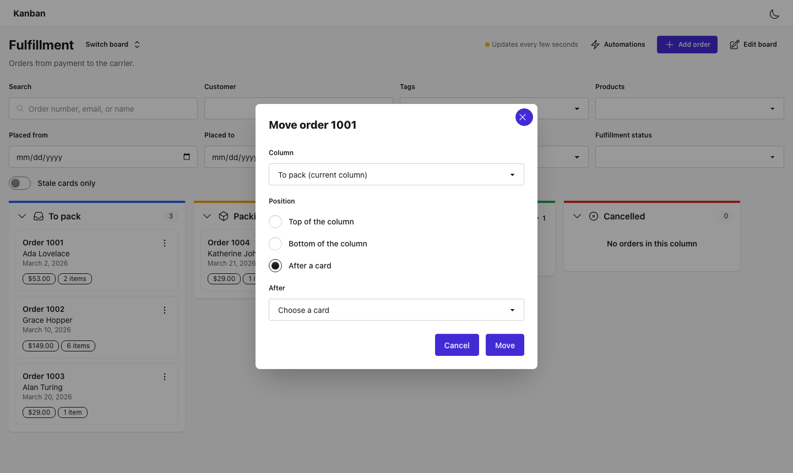
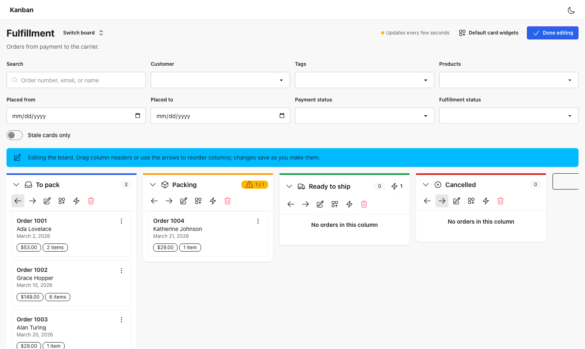

# ArtisanPack UI Ecommerce Kanban (Livewire)

The order kanban board for the [`artisanpack-ui/ecommerce`](https://github.com/ArtisanPack-UI/ecommerce) engine, built on
[`livewire-ui-components`](https://github.com/ArtisanPack-UI/livewire-ui-components) and
[`livewire-drag-and-drop`](https://github.com/ArtisanPack-UI/livewire-drag-and-drop). Staff see orders as cards in
columns by sub-status and move them by drag-and-drop, keyboard, or a "Move to…" dialog. Every move goes through the
engine, so WIP limits, the order status roll-up, and automations always apply. The board adds a filter bar, a card
slide-out, board-native column and card-widget editing, an automations panel, and real-time sync through Laravel Echo
(Reverb, Pusher, or any broadcaster) with a polling fallback. It renders inside the `cms-framework` admin or the
ecommerce admin when either is installed, and as a standalone page otherwise.

## Screenshots






## Requirements

- PHP 8.3+
- Laravel 12 or 13
- Livewire 3.6+ or 4
- `artisanpack-ui/ecommerce` 1.2+
- `artisanpack-ui/livewire-ui-components` 2.1
- Tailwind CSS 4 and daisyUI 5 (`~5.0`) in your application's Vite build
- `@artisanpack-ui/livewire-drag-and-drop` 2.1+ imported in your main script

Optional: `artisanpack-ui/ecommerce-admin-livewire`, `artisanpack-ui/cms-framework`, `laravel/reverb` (or any Laravel
broadcaster with Laravel Echo). See [Requirements](docs/installation/requirements.md).

## Installation

```bash
composer require artisanpack-ui/ecommerce-kanban-livewire
php artisan ecommerce-kanban:install
```

The install command publishes `config/artisanpack/ecommerce-kanban-livewire.php`, prints the front-end lines, and checks
the engine version, the active boards, and real-time sync. It never edits your files.

## Quick start

1. **Add the board to your front end.** Add the `@source` lines the install command prints to your Tailwind entry,
   then install and import drag-and-drop:

   ```css
   @source "../../vendor/artisanpack-ui/ecommerce-kanban-livewire/resources/views/**/*.blade.php";
   @source "../../vendor/artisanpack-ui/ecommerce-kanban-livewire/src/**/*.php";
   ```

   ```bash
   npm install @artisanpack-ui/livewire-drag-and-drop@^2.1.0
   ```

   ```js
   // resources/js/app.js
   import '@artisanpack-ui/livewire-drag-and-drop';
   ```

   Then run `npm run build`. See [Front-End Setup](docs/installation/front-end.md).

2. **Grant access.** The engine denies every ability by default, so the board returns 403 until you grant access. In a
   service provider's `boot()`:

   ```php
   Gate::define( 'ecommerce.admin', fn ( $user ) => $user->is_admin );
   ```

   Or define `ecommerce.kanbanBoard.viewAny`, `ecommerce.kanbanBoard.view`, `ecommerce.kanbanCard.move`, and
   `ecommerce.kanbanBoard.update` individually. See [Authorization](docs/advanced/authorization.md).

3. **Create a board** in the ecommerce admin or through the engine's REST API, or seed a demo store with a board on a
   development database:

   ```bash
   php artisan ecommerce:seed-demo
   ```

4. **Open the board** at `/ecommerce-kanban` (the `board.route_prefix` config key).

Boards poll for changes every 30 seconds. For live boards, set `ECOMMERCE_KANBAN_BROADCAST=true`, configure a
broadcaster, and set up Laravel Echo on `window.Echo`. See [Real-Time Updates](docs/realtime.md).

## Documentation

- [Documentation home](docs/home.md)
- [Quick start guide](docs/getting-started.md)
- [Installation](docs/installation.md): [requirements](docs/installation/requirements.md),
  [configuration](docs/installation/configuration.md), [front-end setup](docs/installation/front-end.md),
  [layouts](docs/installation/layouts.md)
- [Real-time updates](docs/realtime.md): [broadcasting with Echo](docs/realtime/broadcasting.md),
  [polling fallback](docs/realtime/polling.md)
- [Usage](docs/usage.md): [board picker](docs/usage/board-picker.md), [moving cards](docs/usage/moving-cards.md),
  [filters](docs/usage/filters.md), [card detail](docs/usage/card-detail.md),
  [editing the board](docs/usage/editing-the-board.md), [automations](docs/usage/automations.md)
- [Extending](docs/extending.md): [hooks reference](docs/extending/hooks-reference.md),
  [card and toolbar actions](docs/extending/card-actions.md), [card widgets](docs/extending/card-widgets.md),
  [filter controls](docs/extending/filter-controls.md), [embedding components](docs/extending/embedding-components.md)
- [Accessibility](docs/accessibility.md) and [localization](docs/localization.md)
- [Advanced](docs/advanced.md): [authorization](docs/advanced/authorization.md),
  [Artisan commands](docs/advanced/artisan-commands.md), [performance](docs/advanced/performance.md),
  [browser tests](docs/advanced/browser-tests.md)

## Contributing

As an open source project, this package is open to contributions from anyone. Please [read through the contributing
guidelines](CONTRIBUTING.md) to learn more about how you can contribute to this project.

```bash
composer test           # unit and feature tests
composer lint           # php-cs-fixer (dry run) and phpcs
composer test:browser   # browser suite; see docs/advanced/browser-tests.md
```

## License

The MIT License. See [LICENSE](LICENSE) for details.
